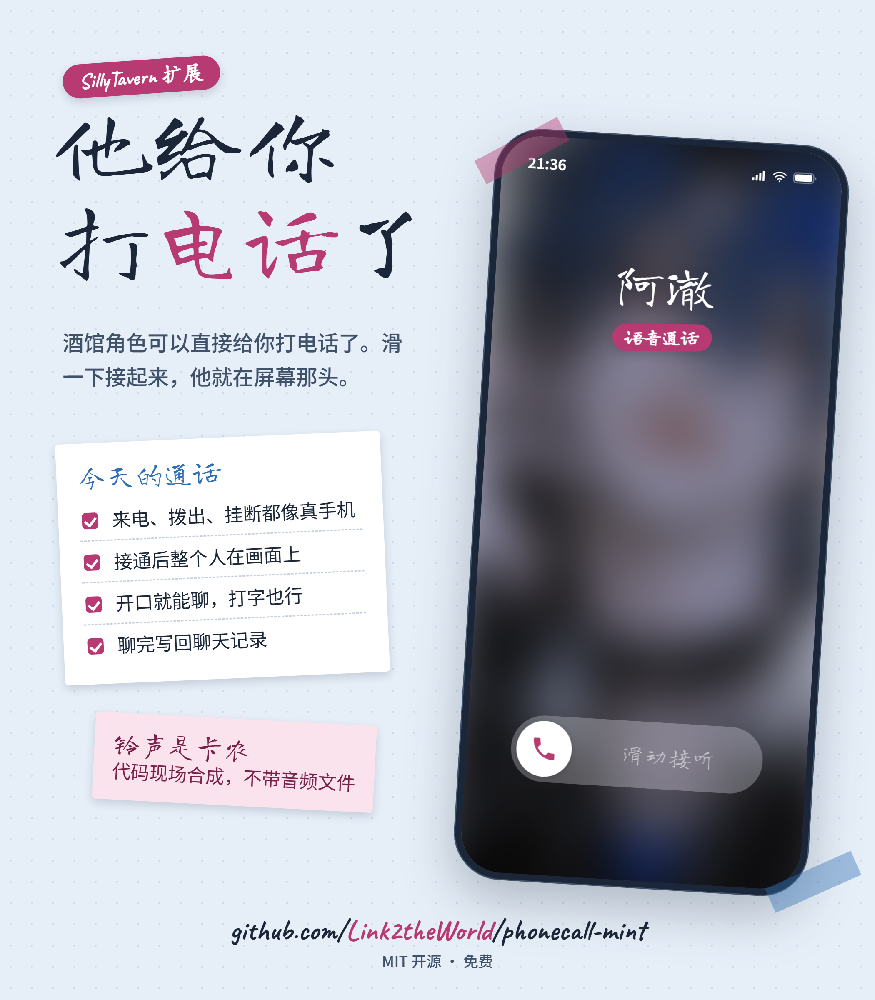

# phonecall-mint 📞

让酒馆角色给你打电话。一个可以嵌进任何前端的「打电话」界面组件，附带 SillyTavern（酒馆）扩展。



## 酒馆一键安装

**方法一：在酒馆里装（最简单）**
打开酒馆 → 顶栏「扩展」 → 「安装扩展」 → 粘贴下面这个地址 → 确定：

```
https://github.com/Link2theWorld/phonecall-mint
```

**方法二：Windows 一行命令**（在 PowerShell 里粘贴回车，自动找到酒馆目录）

```powershell
irm https://raw.githubusercontent.com/Link2theWorld/phonecall-mint/main/install.ps1 | iex
```

**方法三：Mac / Linux / 安卓 Termux 一行命令**

```bash
curl -fsSL https://raw.githubusercontent.com/Link2theWorld/phonecall-mint/main/install.sh | bash
```

找不到酒馆时脚本会问你路径，也可以先设好 `ST_DIR`。再跑一次就是更新。装好后刷新酒馆，魔杖菜单里会有「打给角色」「让角色打来」，也可以输入 `/call`、`/ring`。

## 它能做什么

- 来电页：来电人名字、副标题、模糊背景、**滑动接听**（或「接听 / 拒绝」两个按钮）
- 拨出页：正在呼叫…、回铃音、取消
- 通话页：接通后角色图从模糊变清晰、**整个人铺满画面**；顶部圆形按钮栏（扬声器 / 摄像头 / 静音 / 翻转 / 打字 / 挂断）、名字和计时、实时字幕、打字输入
- 两套外观：经典风格，和手帐风格 `theme="diary"`（手写体、贴纸、纸条字幕）
- 结束页：通话结束 + 时长
- 来电铃声是代码合成的帕赫贝尔《D 大调卡农》（公版曲目，不带任何音频文件），也可以换成自己的音频
- 原生 Web Component，零依赖，Shadow DOM 隔离样式，不会和宿主页面打架
- 通话逻辑全部可插拔：语音识别、回复生成（任意大模型）、语音合成都能换

许可证：**MIT**，见 [LICENSE](LICENSE)。开源、商用都可以，保留版权声明就行。

## 0. 一行命令，让你的 AI 把它接进你的前端

在你的前端项目根目录跑：

```powershell
npx phone-call-ui init
```

它会：

1. 用你项目的包管理器（npm / pnpm / yarn / bun）装上 `phone-call-ui`
2. 识别你的框架（React / Next.js / Vue / Nuxt / Svelte / Angular / 纯 HTML）
3. 给你的 AI 编程助手留好接入说明：`.claude/skills/phone-call-ui/SKILL.md`（Claude Code）和 `AGENTS.md`（Codex、Cursor、Copilot 等都会读）。说明全文在包里的 [AI.md](AI.md)
4. 打印一句话，粘给你的 AI 就行

想一步到位，就让命令直接把 AI 叫起来：

```powershell
npx phone-call-ui init --with claude
```

```powershell
npx phone-call-ui init --with codex
```

没有 npm 的纯静态网站用 `--vendor`，会把文件直接复制到项目里。

---

## 1. 在 SillyTavern 里用

在酒馆里打开 **扩展 → 安装扩展**，填这个仓库的 Git 地址。装好之后：

- 魔杖菜单里多了 **打给角色** 和 **让角色打来**
- 斜杠命令：`/call`（打给角色）、`/ring`（角色打来）、`/hangup`（挂断）
- 扩展设置里有一个 **Phone Call 电话** 面板：语言、浏览器音色、语速、布局、是否写回聊天记录、可选的 TTS 接口

工作方式：

| 环节 | 默认 | 可换成 |
|---|---|---|
| 听你说话 | 浏览器语音识别（Chrome / Edge） | 关掉麦克风，只打字 |
| 角色回复 | 酒馆当前连接的模型（`generateQuietPrompt`，带角色卡和聊天上下文） | — |
| 角色声音 | 浏览器自带语音合成 | 任何 OpenAI 兼容的 `/v1/audio/speech` 接口（本地 GPT-SoVITS / CosyVoice 等的兼容服务都行） |
| 通话记录 | 每句话写回当前聊天（`extra.phone_call = true`） | 关掉，只在通话里保留上下文 |

电脑上是右下角的悬浮手机，手机上自动全屏。群聊暂不支持。

## 2. 在任何网页里用

```html
<script type="module" src="./src/phone-call.js"></script>

<phone-call id="call" name="小雨" subtitle="语音通话" avatar="avatar.png"></phone-call>

<script type="module">
  const call = document.getElementById('call');
  call.incoming();                       // 来电
  call.addEventListener('pc-answer', () => call.caption('喂？', { who: 'them' }));
  call.addEventListener('pc-hangup', (e) => console.log('挂断', e.detail));
</script>
```

只要界面，上面就够了。想要完整的「能对话的电话」，再接上 `createCallSession`：

```js
import { createCallSession } from './src/call-session.js';

const session = createCallSession(call, {
  lang: 'zh-CN',
  // 必填：你的模型。可以返回字符串、Promise<string>，或者流式的 AsyncIterable<string>
  async *reply(userText, { history, direction, signal }) {
    const res = await fetch('/api/chat', { method: 'POST', signal, body: JSON.stringify({ userText, history }) });
    for await (const chunk of res.body.pipeThrough(new TextDecoderStream())) yield chunk;
  },
  // 可选：你的 TTS。返回 Blob / 音频 URL / <audio>；不传就用浏览器语音
  async speak(text, { signal }) {
    const r = await fetch('/api/tts', { method: 'POST', signal, body: text });
    return r.blob();
  },
  onTurn: (turn) => console.log(turn.role, turn.text),
});

session.ring({ name: '小雨', avatar: 'avatar.png' });   // 角色打来，接听后角色先开口
session.dial({ name: '小雨', avatar: 'avatar.png' });   // 你打过去，响几声后角色接起
```

回复按句子切开，一边生成一边念；你一开口（或打字）就会打断角色。

### React / Vue

它就是一个普通的 HTML 标签。React 里用 `ref` 调方法、`addEventListener` 收事件；Vue 里直接 `@pc-answer="..."`。

## 3. API

### 属性

| 属性 | 说明 |
|---|---|
| `name` | 来电人名字 |
| `subtitle` | 来电页副标题，默认「语音通话」，可以写 `FaceTime` |
| `avatar` | 头像图片 |
| `background` | 背景图（默认用头像模糊） |
| `controls` | 按钮栏，逗号分隔：`speaker,camera,mute,flip,keypad,end`，默认 `speaker,camera,mute,flip,end` |
| `answer-style` | `slide`（默认，滑动接听）或 `buttons`（接听 / 拒绝） |
| `active-view` | 接通后的画面：`full`（默认，角色图从模糊变清晰、铺满全屏，说话时轻微呼吸）或 `avatar`（圆形头像 + 声波圈） |
| `theme` | 不填是经典风格；`diary` 是手帐风格：手写体名字、贴纸计时、纸条字幕和胶带、粉色挂断键（会从 Google Fonts 加载龙藏体 / Caveat / 思源黑体，加 `no-webfonts` 可不加载） |
| `floating` / `fullscreen` | 悬浮在右下角 / 铺满屏幕 |
| `no-status-bar` `no-info` `no-captions` | 隐藏状态栏 / 名字计时 / 字幕 |
| `ringtone` / `ringback` | 自定义来电铃声 / 回铃音的音频地址（不填就用内置卡农 / 450Hz 回铃音） |
| `silent` `no-vibrate` | 不响铃 / 不振动 |
| `ring-volume` | 铃声音量 0–1，默认 0.5 |
| `status-time` | 状态栏固定显示的时间，比如 `10:30` |
| `max-captions` | 同时显示几行字幕，默认 3 |
| `ended-delay` | 「通话结束」停留毫秒数，默认 1600 |
| `state`（只读） | `idle` `incoming` `outgoing` `active` `ended` |

### 方法

`incoming(opts)` · `outgoing(opts)` · `answer()` · `connect()` · `decline()` · `hangup(reason)` · `reset()`
`caption(text, { who, id, partial })` · `releaseCaption(id)` · `removeCaption(id)` · `clearCaptions()`
`getControl(name)` · `setControl(name, on)` · `setLevel(0..1)` · `pulse(on)` · `attachAudio(audioOrStream)` · `detachAudio()`

### 事件（都冒泡，带 `pc-` 前缀）

`pc-statechange` · `pc-answer` · `pc-connect` · `pc-hangup {reason, duration}` · `pc-ended` · `pc-toggle {control, on}` · `pc-action {control}` · `pc-text {text}`

### 样式

CSS 变量：`--pc-height` `--pc-aspect` `--pc-radius` `--pc-font` `--pc-backdrop` `--pc-shadow` `--pc-z` `--pc-right` `--pc-bottom`。
`::part()`：`phone` `backdrop` `status-bar` `incoming` `outgoing` `active` `ended`。
文字全部可改：`call.labels = { slideToAnswer: 'slide to answer', ended: 'Call ended', ... }`。

### 画面插槽

不放东西时显示头像。想放视频、Live2D、canvas，塞进 `slot="media"` 就会铺满背景（来电时自动模糊）：

```html
<phone-call name="小雨"><video slot="media" src="loop.mp4" autoplay muted loop playsinline></video></phone-call>
```

## 4. 本地跑演示

```powershell
python -m http.server 5178
```

打开 http://localhost:5178/demo/ 。演示里的角色台词是写死的，只用来看界面和流程。

## 说明

- 图标、铃声都是本项目自己画、自己合成的，不含任何系统素材。
- 请不要用这个组件冒充真人来电，或者把真人的肖像和声音接进去做成「真人通话」。
